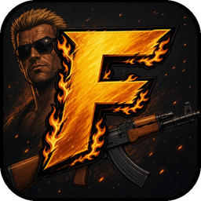
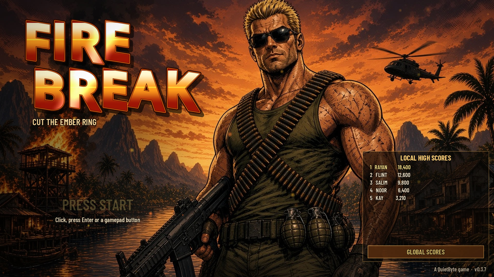
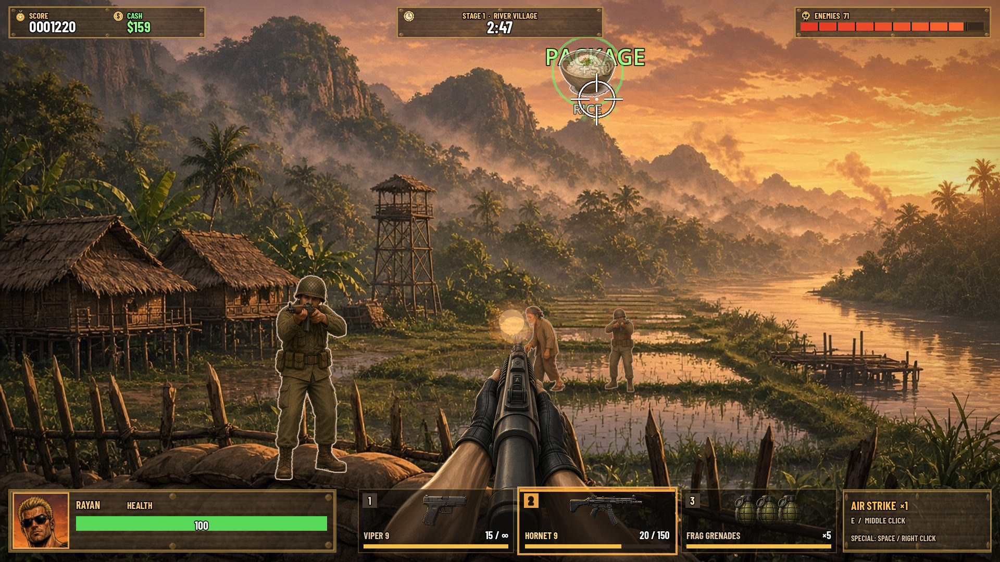

# Firebreak

An Operation Wolf-style gallery shooter for Linux by QuietByte. Hold your position as the
battlefield pans slowly across a jungle river village at dusk and then a high-noon desert:
shoot riflemen, machine-gun nests, camel scouts and convoys, spare the civilians, and shoot
falling food and supplies.

**Version 0.4.0 — early development build.** Stages 1 and 2 of a planned twelve (River Village
and Dune Sea), with painted character sprites, an enemy helicopter (stage 1), a technical and
convoy (stage 2), grenades and air strikes, a Rayan title screen, music, sound effects and
voice lines. Enemies face and fire at you (0.2.1). 0.3.0: ink
outlines on every character, the helicopter and pickups; 19 original weapons in a 3-slot
loadout (pistol, primary, special) with their own magazines and fire sounds; cash and a Store.
0.3.1: a first-person view of the selected weapon held in Rayan's arms (sway, recoil, muzzle
flash and sparks, launcher back-blast), and pausing now freezes every sound and plays a calm
pause-menu track. 0.3.3: an optional global top 100 at firebreak.quietbytehq.uk, with campaign
scores added up across a run.

## Play

Download Linux packages from [GitHub Releases](https://github.com/quietbytehq/firebreak/releases): the `Firebreak-0.4.0-linux-x86_64.tar.gz` archive (extract it and run `Firebreak/play.sh`), a `.deb`, and an AppImage. Confirm the files against `SHA256SUMS-0.4.0`. Godot is not required to play the exported build. OpenGL 3.3-compatible graphics are required. The archive launcher selects native Wayland on a Wayland desktop.

A Snap Store package named `firebreak-game` is set up in this repository. Once it is published you can install it with `snap install firebreak-game`. A Windows zip may also be attached to the GitHub release for testing; it has not been run on Windows and is not supported.

From this source tree, run `./tools/build-linux.sh` once, then `./play.sh`. The game starts fullscreen; F11 toggles windowed mode. This is an early development build (stages 1 and 2 of a planned twelve); public tags are marked as pre-release until later stages ship.

## How it plays

- The stage lasts at most **3 minutes**. Down the enemy quota to clear early, or survive
  until the timer runs out.
- Enemies stand at three depths: **near** (big, hit hardest), **middle** and **far**
  (small, harder to hit, worth more). A red pulsing ring means a soldier is about to fire.
- **Villagers** walk through the scene. Shooting one costs 10 health and 500 points. The
  crosshair turns blue over a villager.
- **Food** falls from the sky: shoot it to heal. **Supplies** fall too: ammo (refills the
  selected gun, or the primary while the pistol is selected), grenades (refill the special
  slot), rapid fire, spread shot, weapon power and **money** ($150 and $400 bags: shoot them).
- You carry **three weapons**: a pistol (slot 1), an SMG or rifle (slot 2) and a special
  (slot 3). Each has its own magazine and reserve, shown in the weapon bar at the bottom. The
  starter Viper 9 pistol never runs out; the Hornet 9 SMG and 5 Frag Grenades are free too.
  Every stage tops each weapon up to its issue ammo. If your primary runs completely dry, an
  ammo drop is sent in.
- **Cash**: kills pay $15 (rifleman) to $250 (helicopter), with a bonus for farther targets,
  MG nests pay $60 and the door gunner $50. Hitting a villager costs $300 as well as health
  and score. Cash is kept even if a mission fails.
- The **Store** (title menu, result screen) sells 5 pistols, 5 SMGs, 5 rifles and machine
  guns and the specials (Hammer RPG, Tankbuster, Thumper GL, extra Air Strikes): buy, equip
  into a slot and buy ammo.
- A **grenade** flies to the crosshair and clears about 30% of the screen around it
  (radius about 445 px). It hurts everyone inside, civilians included, so time it well.
- The **air strike** (1 per stage, plus a rare drop) sends jets over to destroy every enemy,
  vehicle and helicopter on screen. It never harms civilians.
- An **enemy helicopter** crosses stage 1 with a door gunner. Shoot the gunner to silence it, or
  keep hitting the airframe until it smokes and crashes. Stage 2, **Dune Sea**, has no helicopter:
  instead a pickup **technical** drives by with a bed gunner, camel scouts ride through, rooftop
  **snipers** take long aim, and a **convoy truck** is the mid-boss.

## Controls

| Action | Mouse / keyboard | Gamepad |
| --- | --- | --- |
| Aim | Mouse; arrow keys or WASD | Left stick or D-pad |
| Fire (hold for automatic) | Left click or Ctrl | A or RT |
| Reload | R | X |
| Select weapon slot | 1, 2, 3 or click the slot in the weapon bar | – |
| Next / previous weapon | Q or wheel down / wheel up | LB / Y |
| Special (grenade or launcher) | Space, right click or G | B or LT |
| Air strike | E or middle click | RB |
| Pause | Esc or P | Start |
| Fullscreen | F11 | – |

Every action can be remapped on the **Controls** screen (title or pause menu). The pause menu
also turns music on or off, picks one of three tracks and sets music and effects volume. While
paused every game sound freezes and a calm pause-menu track plays; resuming picks up where it left off. Remaps,
settings, the local top-ten scores and your cash, weapons and ammo are saved in the Godot user folder
(`~/.local/share/QuietByte/Firebreak/`).

## Development

- Engine: Godot 4.7.2 (GDScript, GL Compatibility renderer), 1920×1080 base resolution.
- `tools/test.sh` runs the isolated headless test suites in `tests/`.
- `tools/build-linux.sh` exports `build/linux/Firebreak.x86_64` and assembles `build/Firebreak/` for local play.
- `packaging/build_linux.sh` packages the Linux export as `Firebreak-<version>-linux-x86_64.tar.gz`, `firebreak_<version>_amd64.deb` and (when appimagetool is available) an AppImage, all under `dist/`.
- `tools/package-release.sh` exports and then runs that packager, and writes `SHA256SUMS`.
- `tools/build-snap.sh` builds a strict core24 snap named `firebreak-game` from the `.deb` (optional; does not upload). `snap/snapcraft.yaml` lists the `network` plug for the scoreboard.
- A version tag (`v0.4.0`) starts GitHub Actions: Linux and Windows exports, packages attached to a pre-release, and a snap uploaded to the Snap Store `edge` channel.
- Stages are data: see `data/campaign.json`, `data/stages/stage_01.json`, `data/stages/stage_02.json` and `docs/DESIGN.md`.
- Art prompts and sprite notes: `ART_PROMPTS.md`. Audio catalogue: `AUDIO_BRIEF.md`.
- Weapons, prices and the economy are data: `data/weapons.json`.
- Art tools: `tools/art/cut_heli_sheet.py` (cuts the helicopter/jet sheet),
  `tools/art/sprite_meta.py` (regenerates `scripts/sprite_meta.gd`), `tools/art/cut_icons.py`
  and `tools/art/contact_sheet.py` (weapon icons) and `tools/art/bake_outlines.py` (outlines).
  `tools/art/cut_fp.py` and `tools/art/fp_contact_sheet.py` (first-person weapon views; muzzle
  and back-blast points in `data/fp_weapons.json`).
- QA results: `QA_REPORT.md`. Changes by version: `CHANGELOG.md`.

## Global top 100

After a qualifying run (2,000 points or more) you can post your name and campaign score to
the global top 100 at [firebreak.quietbytehq.uk](https://firebreak.quietbytehq.uk). The name-entry
screen tells you this; press Tab to keep the score on your computer only. The choice is
remembered. The post is never required, and the game does not wait for the network. If there
is no internet the post is dropped. Only the typed name, the score, the mode, the game version
and the last stage reached are sent. Because the game is open source, a submitted score cannot
be proved genuine.

0.3.4: civilians face the way they walk; sticker outlines; first-person rear firing views with a
side reload pose on magazine guns (the Thunder M60 and launchers dip without a pose change);
muzzle tracers and smoke trails; popping scores, streak callouts and a stage title card; head
shots with a CLEAN SHOT bonus; pricier guns never hit softer than cheaper ones of the same type;
eleven new Rayan catchphrases that unlock as you clear stages.

0.3.5: Rayan is blended into the mission-failed and stage-clear screens (feathered cut-out, grading and a left vignette) instead of sitting in a hard rectangle. Bullet tracers are gone; the barrel now throws a bigger flash, sparks and a puff of smoke on every shot. Rocket and grenade trails are a little softer.

0.4.0: Stage 2, Dune Sea, is playable (high noon, shemagh militia, snipers, camel scouts, a technical and a convoy mid-boss). After River Village the travel map continues into Dune Sea; clearing it previews Coral Coast as coming soon. Heat shimmer and a short dust storm. Stage 2 music and desert effects are third-party CC0 recordings (see NOTICE). The Godot app icon is the same sub-256 kB palette PNG as the store icon.
0.3.7: One START button (the briefing plays the first time, and can be rewatched with F1 or from pause). Near enemies stand above the bottom HUD. A spoken “FIREBREAK!” calls over the title music once per launch. The title shows this computer’s high scores and a GLOBAL SCORES link that opens the public board. The briefing panel fades into the map. The app icon is a flaming gold F, with a quieter Rayan bust and a generic Kalash-style rifle behind it, readable at small sizes. Linux packages and a Snap Store pipeline (`firebreak-game`) are included.
0.3.6: A cinematic title theme plays from launch. The opening briefing and a travel map for the Ember Ring campaign are in the game. The top HUD uses military plates, icons and the Barlow Condensed typeface. Stage 2 is still not playable.

## Known limitations (0.4.0)

- Only stages 1 and 2 are playable; stages 3–12 are planned.
- The stage 1 supply truck is still drawn in code. Stage 2 vehicles use painted sprites. The ElevenLabs plan behind the older audio is not yet confirmed
  (see `NOTICE`).
- Tested on Linux x86-64 with Intel Mesa graphics only. No physical gamepad was tested.
  A Windows zip may be produced by the release CI; it has not been run on Windows and is not supported.
- The Store is not reachable from the pause menu mid-stage. Launcher rounds reuse the grenade
  in-flight art, and Rayan's portrait does not change with the selected weapon.
- First-person view: launchers still show the loaded rocket while reloading, and the arms
  turn see-through when the reticle is over them.

## Licence

Source code: Apache-2.0 (see `LICENSE`). Attributions and asset terms: `NOTICE`.
Third-party licences: `LICENSES/`. Contact: hello@quietbytehq.uk

Source: https://github.com/quietbytehq/firebreak
